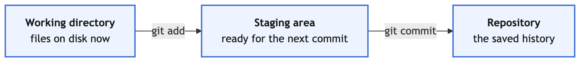

# 1. Setup and Your First Repository

Git is the tool you will use to save your work for the rest of this bootcamp, and GitHub is
where that work will live. Today you build both habits from nothing.

You will create every file in these exercises yourself. That is deliberate: the point is not
to watch a repository appear, it is to know what each command did to it.

## Objectives

At the end of this exercise you should be able to:

- Tell git who you are, so your commits carry your name.
- Turn any folder into a git repository.
- Read `git status` and say what it is telling you.
- Move a change from your working folder, to the staging area, to a commit.
- Read your own history with `git log`.

## Tell git who you are

Do this once on your machine. Every commit you ever make will carry these values.

```bash
git config --global user.name "Your Name"
git config --global user.email "your@email.com"
```

Three more settings that will save you trouble later:

```bash
git config --global init.defaultBranch main
git config --global pull.ff only
git config --global core.editor "code --wait"
```

Check what you set:

```bash
git config --list
```

> [!NOTE]
> The second setting makes `git pull` refuse to create a merge commit behind your back. If a
> pull ever fails because of it, that is the setting doing its job: it means the history has
> moved in a way you should look at before continuing.

> [!TIP]
> The third setting matters from exercise 2 onwards. Merges, amends and reverts ask you to
> write or confirm a message, and without this setting git opens a terminal editor (often
> vim) that is hard to leave if you have never used it. With it, git opens the message in
> VS Code: edit or accept the text, save, and close the tab to hand control back to git.
> If you ever do land in vim, press `Esc`, type `:wq` and press `Enter`.

## The three places a change can be

This is the one idea that makes everything else make sense.

| Place | What it means |
| :---- | :------------ |
| Working directory | The files as they are on disk right now |
| Staging area | The changes you have chosen to include in the next commit |
| Repository | The commits, the saved history |

`git add` moves a change from the first to the second. `git commit` moves everything staged
from the second to the third.



## The task

Work through these in order. **After every numbered step, run `git status` and read it**,
even when the step does not tell you to. Learning to read that output is the real exercise.

1. Make a new folder called `recipes` and move into it.
2. Run `git status`. What does git say, and why?
3. Turn the folder into a repository with `git init`.
4. Run `git status` again. What changed in the output?
5. Create a file called `pancakes.md` and write a title line into it.
6. Run `git status`. What is git calling your new file?
7. Stage the file with `git add pancakes.md`.
8. Run `git status`. Which section is the file in now?
9. Commit it with a message that says what you did.
10. Run `git status`. Why is it so quiet?
11. Run `git log`. Then run `git log --oneline`. Which will you use more often?
12. Add a list of ingredients with quantities to `pancakes.md`, one per line, for example
    `- 1 cup flour`. You will change these quantities in exercise 3.
13. Run `git status`, then `git diff`. What is the difference between what those two show you?
14. Stage the change, then run `git diff` again. Where did your change go?
15. Run `git diff --staged`. There it is.
16. Commit, then create a second file `waffles.md` and commit that too.
17. Run `git log --oneline`. You should have three commits.

## Check your understanding

1. You edited a file but `git status` does not mention it. Give two reasons that could happen.

   <details>
   <summary>Show answer</summary>

   Two common reasons:

   - The edit was never saved. Git only sees what is on disk, not what is open in your editor.
   - The file is listed in `.gitignore`, so git is ignoring it deliberately.

   A third possibility: you are in a different repository from the one you edited, so `git status` is reporting on the wrong folder.

   </details>

2. What is the difference between `git diff` and `git diff --staged`?

   <details>
   <summary>Show answer</summary>

   `git diff` shows changes you have **not** staged yet, comparing your working directory against the staging area. `git diff --staged` shows what you **have** staged, comparing the staging area against the last commit. Together they cover everything between your last commit and the file on disk. If both are empty, everything is committed.

   </details>

3. You ran `git add` on a file and then edited it again before committing. Which version goes
   into the commit?

   <details>
   <summary>Show answer</summary>

   The version you staged. `git add` takes a snapshot of the file at that moment, so later edits are not included until you `git add` again. This catches people out regularly, which is why running `git status` before committing is a good habit: the file will be listed as both staged and modified.

   </details>

4. Why does git ask for your name and email rather than reading them from your computer?

   <details>
   <summary>Show answer</summary>

   Git is distributed, so there is no server holding your identity. Every commit records the author's name and email itself, and that information travels with the commit into every copy of the repository. Git asks once rather than guessing from your computer's account name, which is often something like `admin` and would be meaningless in a shared history.

   </details>

## Useful commands

- `git init` turn the current folder into a repository
- `git status` what is changed, staged, and untracked
- `git add <file>` stage a file, `git add .` stage everything changed
- `git commit -m "message"` commit what is staged
- `git diff` unstaged changes, `git diff --staged` staged changes
- `git log`, `git log --oneline`, `git log --oneline --graph`
- `touch <file>` create an empty file
- `echo "text" >> <file>` append a line to a file
