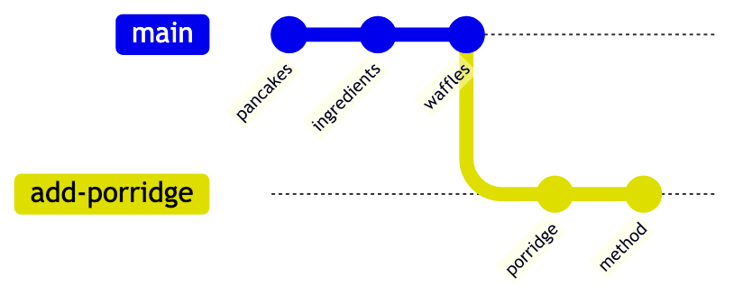
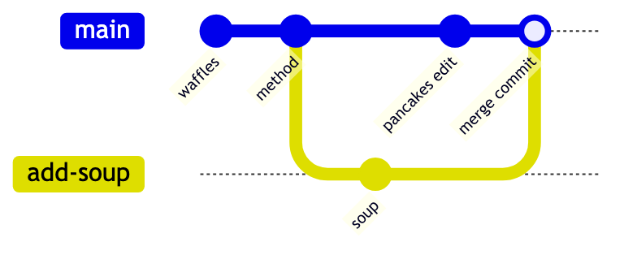

# 2. Branching and Merging

A branch is a way to work on something without disturbing what already works. It is the
habit that makes collaboration possible, and from here on you will use it constantly.

Keep working in the `recipes` repository you built in exercise 1.

## Objectives

At the end of this exercise you should be able to:

- Create a branch and switch to it.
- Identify what a branch actually is, and why creating one is cheap.
- Merge a branch back into `main`.
- Read history as a graph rather than a list.
- Delete a branch once it has served its purpose.

## What a branch really is

A branch is a **movable label pointing at one commit**. That is all. Creating one writes a
few bytes, which is why git users branch so freely compared with older tools.

When you commit on a branch, the label moves forward with you. `main` stays where it was.

## The task

1. Run `git log --oneline --graph --all`. Note the shape before you start.
2. Check which branch you are on with `git branch`.
3. Create a branch called `add-porridge` and switch to it in one step:
   `git switch -c add-porridge`.
4. Run `git branch` again. What marks the branch you are on?
5. Create `porridge.md` with a title and ingredients, then commit it.
6. Run `git log --oneline --graph --all`. Where is `main`, and where is `add-porridge`?
7. Switch back to `main` with `git switch main`.
8. **Look in your folder.** Where did `porridge.md` go? Explain what happened.
9. Switch back to `add-porridge` and confirm the file returns.
10. Add a second commit on the branch, for example a method section in `porridge.md`.
11. Switch to `main` and merge your work: `git merge add-porridge`.
12. Read what git printed. It should mention **fast-forward**. What does that mean here?
13. Run `git log --oneline --graph --all`. Did a merge commit appear? Why not?
14. Delete the branch with `git branch -d add-porridge`, then run `git branch` to confirm.

## A merge that is not a fast-forward

A fast-forward happens only when `main` has not moved. Make it move.

15. Create a branch `add-soup`, commit a `soup.md` file on it.
16. Switch to `main` and commit a change there too, for example a line in `pancakes.md`.
17. Run `git log --oneline --graph --all`. The history has forked. Draw it on paper.
18. Merge `add-soup` into `main`. Git will open an editor for a merge commit message.
    Accept the default: save and close the tab (see the editor tip in exercise 1).
19. Run `git log --oneline --graph --all` once more. Count the parents of the newest commit.

## The two shapes side by side

Compare your drawing from step 17 with the diagrams below.

**Fast-forward (steps 1 to 14).** `main` did not move while you worked on `add-porridge`, so
the merge only slid the `main` label forward to the branch's last commit. No new commit
was made, and the history stays a straight line.

After the merge, `main` points at `method`, the same commit as `add-porridge`.

**Merge commit (steps 15 to 19).** Both branches gained a commit, so git could not just slide
a label. It created a new commit with two parents that joins the two lines of work.

## Check your understanding

1. Why can you create a branch in a huge repository instantly?

   

   
Show answer

   A branch is just a movable label pointing at one commit, stored as a file containing a commit hash. Creating one writes a few bytes and copies nothing, no matter how large the repository is. This is why git users branch freely, where older tools made branching expensive enough to avoid.

   

2. What is the difference between a fast-forward merge and a merge commit?

   

   
Show answer

   A **fast-forward** happens when the branch you are merging into has not moved since the other branch was created. Git simply slides the label forward, and no new commit is made. A **merge commit** is needed when both branches have new commits: git creates a commit with two parents to join the histories, which is why merges show up as a fork and rejoin in the graph.

   

3. You are on `main` and run `git switch -c experiment`. Which commit does `experiment` point
   at?

   

   
Show answer

   The same commit `main` points at. A new branch always starts where you are standing, and `-c` creates it and switches in one step. Nothing is copied, so the two labels point at the identical commit until you commit on one of them.

   

4. `git branch -d` refused to delete a branch. Give a likely reason.

   

   
Show answer

   Most likely the branch has commits that are not merged into the branch you are on, so deleting the label would leave that work unreachable. `-d` is the safe delete and refuses in that case. `-D` forces it, which is right when you genuinely want to abandon the work and wrong the rest of the time.

   

## Useful commands

- `git branch` list branches, `git branch <name>` create one
- `git switch <branch>` move to a branch, `git switch -c <branch>` create and move
- `git merge <branch>` merge that branch into the one you are on
- `git branch -d <branch>` delete a merged branch
- `git log --oneline --graph --all` see the shape of the history
