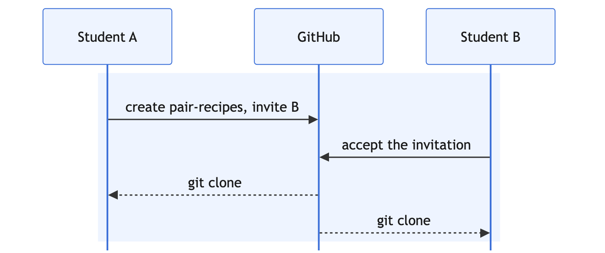
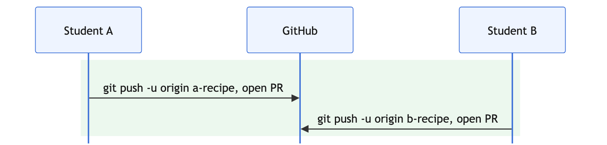
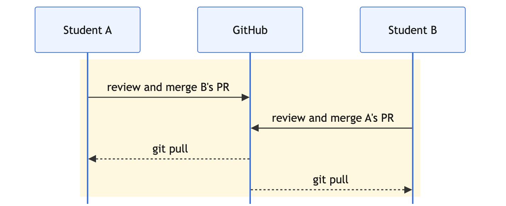
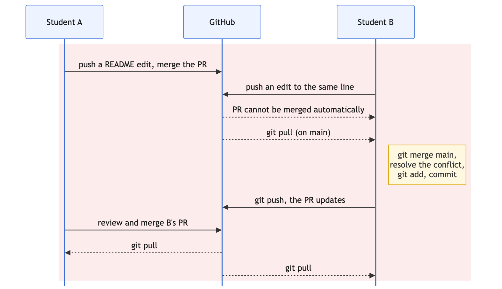

# 6. The GitHub Pair Workflow

Everything so far happened on your own machine. This exercise is the other half: working
with someone else through GitHub.

**Work in pairs.** One of you is **A**, the other is **B**. Decide now, and say it out loud,
because the steps below depend on it.

## Objectives

At the end of this exercise you should be able to:

- Clone a repository from GitHub to your machine.
- Push a branch and open a pull request.
- Review a colleague's pull request and merge it.
- Pull your colleague's merged work down to your machine.
- Resolve a conflict that arises between two people rather than two of your own branches.

## Before you start

You need to be able to talk to GitHub from your terminal. If you have not set up an SSH key,
do that first, then check it works:

```bash
ssh -T git@github.com
```

You should see a greeting with your username. If you are asked for a password, GitHub is not
recognising your key and the rest of this exercise will not work.

## Part 1: one repository, two people

Each part below starts with a diagram of who does what. Solid arrows are something you send to GitHub, dashed arrows are what comes back from it to your machine.



1. **A only:** create a new **public** repository on GitHub called `pair-recipes`, ticking
   the options to add a `README.md`, a `.gitignore` for Python, and an MIT licence.
2. **A only:** in the repository settings, invite **B** as a collaborator.
3. **B only:** accept the invitation. It arrives by email and on GitHub.
4. **Both:** clone it: `git clone <ssh-url>`, then `cd pair-recipes`.
5. **Both:** run `git log --oneline` and `git remote -v`. What is `origin`?

## Part 2: a branch each, and a pull request each



6. **Both:** create a branch named after yourself: `git switch -c <your-name>-recipe`.
7. **Both:** create a file named after your recipe, write a few lines, and commit.
8. **Both:** push the branch: `git push -u origin <your-branch>`.
9. **Both:** read what git printed. It gives you a link to open a pull request.
10. **Both:** open a pull request on GitHub, from your branch into `main`. Write a title and a
    sentence saying what you changed.
11. **Both:** look at the **Files changed** tab. This is what a reviewer sees.

## Part 3: review each other



12. **Both:** open your partner's pull request. Leave a comment on a specific line, then
    approve it.
13. **A:** merge **B**'s pull request. **B:** merge **A**'s.
14. **Both:** on GitHub, look at `main`. Both recipes should now be there.
15. **Both:** back in your terminal, run `git log --oneline`. Your local `main` does not have
    any of it yet. Why not?
16. **Both:** `git switch main`, then `git pull`. Now run `git log --oneline` again.
17. **Both:** delete your merged branch locally with `git branch -d <your-branch>`.

## Part 4: a conflict between two people

This is the one that matters, and the one everybody meets eventually.



18. **Both:** create a new branch, and **both edit the same line of `README.md`** with
    different text. Commit and push.
19. **A:** open a pull request and merge it.
20. **B:** open your pull request. GitHub now says it cannot be merged automatically.
21. **B:** bring `main` into your branch locally:
    ```bash
    git switch main
    git pull
    git switch <your-branch>
    git merge main
    ```
22. **B:** resolve the conflict exactly as in exercise 3: edit the file, remove the markers,
    `git add`, commit.
23. **B:** push again. Watch the pull request update itself.
24. **A:** review and merge it. **Both:** pull `main` and confirm you have identical history.

## Check your understanding

1. What is `origin`, and where did it come from?

   <details>
   <summary>Show answer</summary>

   `origin` is a name for the remote repository, in this case the one on GitHub. `git clone` created it automatically, pointing at the URL you cloned from. It is only a convention, not a keyword: you can rename it or add other remotes, but almost every repository calls its main remote `origin`.

   </details>

2. You committed and it does not appear on GitHub. What step is missing?

   <details>
   <summary>Show answer</summary>

   The push. Committing saves to the repository on your own machine and involves no network at all, which is why you can commit on a train. `git push` is the separate step that sends those commits to GitHub. The habit worth building is commit often, push when you want others to see it.

   </details>

3. Why does `git push -u` only need the `-u` the first time?

   <details>
   <summary>Show answer</summary>

   `-u` sets the upstream, recording that your local branch tracks a branch of the same name on `origin`. Once that link exists, git knows where a bare `git push` or `git pull` should go. Without it you would have to name the remote and branch every time.

   </details>

4. In part 4, why did **B** hit the conflict and not **A**?

   <details>
   <summary>Show answer</summary>

   Because **A** merged first. When A's pull request went in, `main` moved, and B's branch was written against the older `main`. Whoever merges second inherits the conflict, every time. This is the single most useful thing to understand about working with other people: it is not about who was right, only about who arrived second.

   </details>

5. Your colleague merged a pull request an hour ago. What do you run before starting new
   work, and why?

   <details>
   <summary>Show answer</summary>

   `git pull` on `main`, so your local `main` includes their merged work before you branch from it. If you skip it you branch from an outdated `main`: you build and test against code that no longer matches GitHub, and any lines you both touched will conflict when your pull request goes in. Pulling before starting new work is cheap and avoids both.

   </details>

## Useful commands

- `git clone <ssh-url>` copy a remote repository to your machine
- `git remote -v` show where `origin` points
- `git push -u origin <branch>` push a branch and set it to track
- `git push` after the first time
- `git pull` fetch and integrate the remote branch into yours
- `git branch -d <branch>` delete a local branch once merged
- `ssh -T git@github.com` check GitHub recognises your key
